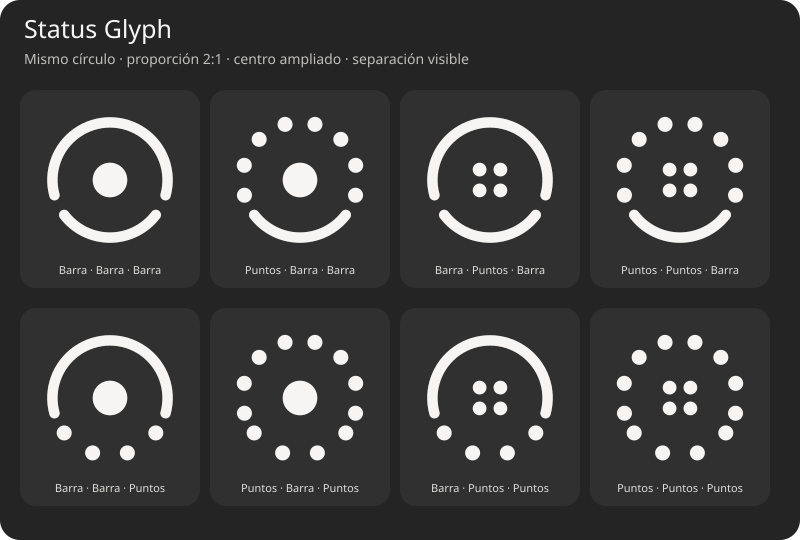

# Status Glyph

Un único widget de escritorio para GNOME Shell con tres canales de información independientes. Dos arcos sobre un mismo círculo: la parte superior ocupa 2/3 del recorrido visible y la inferior 1/3, separados por dos espacios. El centro tiene un diámetro del 30% del círculo; cada parte puede cambiar a puntos, con ocho puntos arriba, cuatro en el centro (2×2) y cuatro abajo.



Previsualización vectorial generada a partir del renderer; no es una captura de GNOME Shell. Cada etiqueta indica principal, centro y secundaria.

**Estado: prototipo v0.1.0.** Código implementado y pruebas unitarias disponibles. La ejecución, integración visual y compatibilidad por versión todavía requieren una sesión real de GNOME Shell. Las versiones 49–51 en metadata son objetivos de desarrollo, no una certificación de compatibilidad.

## Implementado

- Tres métricas configurables: batería, Wi-Fi, Bluetooth, CPU, RAM o temperatura.
- Arcos/puntos por canal, dirección e inversión del nivel.
- Tamaño de 48 a 256 px y opacidad configurable.
- Color heredado del tema de GNOME Shell o dos colores hexadecimales personalizados.
- Ubicación relativa en el área de trabajo y selección de monitor.
- Preferencias GTK4/Libadwaita y persistencia GSettings.
- UPower, NetworkManager y BlueZ por D-Bus; CPU/RAM/temperatura con lecturas asíncronas.
- Un scheduler compartido y proveedores reutilizados entre canales.
- Limpieza de suscripciones, cancelación de lecturas y liberación de contexto Cairo.
- Validación, pruebas y empaquetado mediante GitHub Actions.

## Instalar para desarrollo

Requisitos: GNOME Shell, GJS, GTK4, Libadwaita, Python 3 y `glib-compile-schemas`. NetworkManager, BlueZ y UPower son opcionales: sus métricas muestran un estado no disponible cuando faltan.

Desde la carpeta del proyecto:

```bash
bash scripts/install.sh
```

En Wayland, cerrar sesión y volver a entrar. Después:

```bash
gnome-extensions enable status-glyph@osvaldovar.github.io
gnome-extensions prefs status-glyph@osvaldovar.github.io
```

El widget aparece sobre el fondo, debajo de las ventanas. GNOME Shell es obligatorio; Niri/Noctalia no cargan extensiones de GNOME Shell.

## Desarrollo

Node.js 22 o superior ejecuta las pruebas de lógica sin GNOME; Python genera los paquetes. No hay dependencias npm.

```bash
npm run check
npm test
npm run pack
```

`dist/status-glyph-source.zip` incluye el proyecto. El paquete `dist/status-glyph@osvaldovar.github.io.shell-extension.zip` se genera cuando está disponible el compilador de esquemas GLib. El ZIP fuente no debe instalarse directamente como extensión.

## Métricas

| Métrica | Fuente | Actualización | Representación |
| --- | --- | --- | --- |
| Batería | UPower DisplayDevice | Señales | Porcentaje agregado |
| Wi-Fi | NetworkManager | Señales | Fuerza del punto de acceso activo |
| Bluetooth | BlueZ | Señales | 0 apagado, 0.5 encendido, 1 conectado |
| CPU | /proc/stat | 1 s | Uso entre dos muestras |
| RAM | /proc/meminfo | 2 s | MemTotal menos MemAvailable |
| Temperatura | Zonas térmicas CPU/SoC de sysfs | 5 s | Rango 30–100 °C; máxima de zonas compatibles |

Temperatura no incluye aún hwmon: algunos equipos no exponen zonas térmicas reconocidas. Wi-Fi muestra 0 al estar desconectado; Bluetooth sin adaptador y batería ausente se muestran atenuados. El tema de Shell determina el color automático; no se deduce el contraste del fondo de pantalla.

## Documentación

- [Arquitectura](docs/ARCHITECTURE.md)
- [Verificación manual](docs/TESTING.md)
- [Roadmap](docs/ROADMAP.md)
- [Plan original](docs/PLAN_ORIGINAL.txt)
- [Cambios](CHANGELOG.md)

Referencias de implementación: [módulos GJS](https://gjs.guide/extensions/overview/imports-and-modules.html), [St.DrawingArea](https://gnome.pages.gitlab.gnome.org/gnome-shell/st/class.DrawingArea.html), [código de layout de GNOME Shell](https://github.com/GNOME/gnome-shell/blob/main/js/ui/layout.js).

Licencia MIT.
